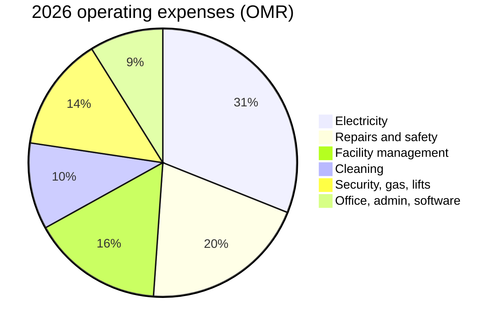

# Golf Tower Muscat

One building, figures in OMR. Income and expenditure is the 12 months ended 30 Sep 2026. The financial statement balance sheet compares 31 Dec 2024 with 31 Oct 2026. Its income and expense column matches the 2026 trading result, not a 22-month total.

| Metric | Amount (OMR) |
|---|---|
| Income in the financial statement | 152,153 |
| Surplus on that income statement | 26,698 |
| Member receivables at 31 Oct 2026 | 70,109 |
| Software billing in the same statement | 1,567 |

## December 2025 is a reversal, not a trading month

Service charge of OMR 139,210 was reversed in December, equal to about six bills of OMR 23,202. Expenses were reversed by OMR 147,533. The 12-month grand total (income OMR 13,309, expenses negative) is that reversal netted against later bills. Read Jan–Sep 2026, or the financial statement, for the operating result.

## Monthly result, December omitted

Income and expenses in OMR. Source: ADDA income and expenditure, Oct 2025–Sep 2026, December 2025 excluded. Service charge is billed in Nov, Jan, Mar, May, Jul and Sep, about OMR 23,000 each time. Apr and Aug have no income.

| Month | Income (OMR) | Expenses (OMR) |
|---|---:|---:|
| Oct 25 | 25 | 12,151 |
| Nov 25 | 25,315 | 9,886 |
| Jan 26 | 23,217 | 13,885 |
| Feb 26 | 1,998 | 10,522 |
| Mar 26 | 26,314 | 9,512 |
| Apr 26 | 0 | 11,055 |
| May 26 | 31,204 | 14,207 |
| Jun 26 | 7,031 | 20,342 |
| Jul 26 | 28,788 | 16,964 |
| Aug 26 | 0 | 15,095 |
| Sep 26 | 33,407 | 11,949 |

```mermaid
xychart-beta
    title "Monthly income and expenses, December omitted (OMR)"
    x-axis [Oct25, Nov25, Jan26, Feb26, Mar26, Apr26, May26, Jun26, Jul26, Aug26, Sep26]
    y-axis "OMR" 0 --> 35000
    bar [25, 25315, 23217, 1998, 26314, 0, 31204, 7031, 28788, 0, 33407]
    bar [12151, 9886, 13885, 10522, 9512, 11055, 14207, 20342, 16964, 15095, 11949]
```

The first series is income. The second series is expenses.

## Where the 2026 money goes

Operating expenses OMR 125,455 from the financial statement (income OMR 152,153 less surplus OMR 26,698). Electricity includes common-area and gym or office power. Cooling income of OMR 35,268 covers most of the OMR 34,009 apartment electricity line.

| Category | Amount (OMR) |
|---|---:|
| Electricity | 38,959 |
| Repairs and safety | 25,168 |
| Facility management | 19,845 |
| Cleaning | 13,085 |
| Security, gas, lifts | 17,251 |
| Office, admin, software | 11,147 |

Facility management is OMR 2,205 a month (OMR 19,845 here). Software is OMR 1,567 in this statement. June and September bills of OMR 520 and OMR 527 imply about OMR 2,080 a year, near USD 5,400.

Software is about 1% of income. The management fee is about thirteen times the software line.

## Balance sheet

Rounded to the nearest OMR.

| | 31 Dec 2024 | 31 Oct 2026 |
|---|---:|---:|
| Bank Muscat | 4,039 | 26,535 |
| NBO current account | 15,620 | (5,532) |
| NBO fixed deposit | 42,206 | 64,314 |
| Member receivables | 61,344 | 70,109 |
| Other receivables | — | 7,452 |
| Payables | 24,848 | 21,733 |
| Sinking fund | 60,410 | 68,410 |
| Retained earnings | 36,366 | 45,200 |
| Surplus shown on the balance sheet | — | 32,230 |

Cash outside the fixed deposit is OMR 22,304, against payables of OMR 21,733. The deposit of OMR 64,314 sits beside a sinking fund of OMR 68,410.

## What does not tie

Listed equity and liabilities total OMR 169,786. Assets total OMR 164,254. The difference is the NBO overdraft of OMR 5,532. The balance-sheet surplus of OMR 32,230 is the income-statement surplus of OMR 26,698 plus that same OMR 5,532. Late-payment interest of OMR 17 was credited straight back to members.

Member receivables rose by OMR 8,765, from OMR 61,344 to OMR 70,109. That balance is about three service-charge cycles for the whole building. The old stock was already there at the end of 2024. Collections kept roughly even with new bills and did not clear the backlog.

## 174 defaulters, OMR 67,372 net due

The collection report shows total due of OMR 68,624, excess payments of OMR 1,252, and a net of OMR 67,372 across 174 names. That is about OMR 387 per defaulter. It sits close to member receivables of OMR 70,109 and is the list to chase. It is a wide, shallow book, not 174 large debts.
